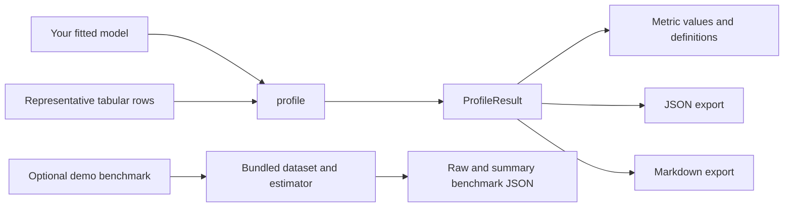

# Model Diet

**Profile the inference cost of a fitted Python model before deployment.**

[](https://github.com/modeldiet/modeldiet/actions/workflows/ci.yml)
[](https://github.com/modeldiet/modeldiet/actions/workflows/docs.yml)
[](https://github.com/modeldiet/modeldiet/blob/master/pyproject.toml)
[](LICENSE)

Model Diet helps ML engineers understand how an already-fitted model behaves at inference time. Give it representative tabular inputs; it returns structured measurements you can inspect or export as JSON and Markdown.

## Install

**Model Diet is not currently published on production PyPI.** PyPI's [package metadata endpoint](https://pypi.org/pypi/modeldiet/json) returned 404 when checked on November 7, 2026, so `pip install modeldiet` is not a verified installation method. Install from the source repository instead:

```bash
git clone https://github.com/modeldiet/modeldiet.git
cd modeldiet
python -m pip install .
```

The core package requires Python 3.11+ and depends on NumPy and psutil. It does not require scikit-learn or XGBoost; you can profile a compatible model of your own without those libraries.

The copy-and-run quickstart below uses scikit-learn. Install the demo extra from the repository checkout to run it:

```bash
python -m pip install ".[demo]"
```

The optional benchmark tools have separate extras:

| Install from the repository checkout | Includes | Use |
| --- | --- | --- |
| `python -m pip install ".[benchmark]"` | pandas and scikit-learn | Logistic Regression and Random Forest benchmark runs |
| `python -m pip install ".[benchmark-xgboost]"` | pandas, scikit-learn, and XGBoost | XGBoost benchmark runs |
| `python -m pip install ".[demo]"` | pandas, scikit-learn, and XGBoost | All documented demo examples and benchmark types |

The test release `0.1.0` is available from [TestPyPI](https://test.pypi.org/project/modeldiet/), but it is not a production release. To try it, let pip use TestPyPI for Model Diet and production PyPI for its dependencies:

```bash
python -m pip install \
  --index-url https://test.pypi.org/simple/ \
  --extra-index-url https://pypi.org/simple/ \
  "modeldiet[demo]==0.1.0"
```

Use the source installation above for development from the repository.

## Quickstart

This trains a small Random Forest, profiles it with the default latency measurement, and writes both report formats. It requires the `demo` extra.

```python
from pathlib import Path

import numpy as np
from sklearn.ensemble import RandomForestClassifier

from modeldiet import profile

rng = np.random.default_rng(42)
X = rng.random((100, 5))
y = rng.integers(0, 2, size=100)

model = RandomForestClassifier(n_estimators=20, random_state=42)
model.fit(X, y)

result = profile(model=model, X=X, include_environment=True)
mean_ms = result.measurements["latency"].metrics["mean_ms"].value
print(f"Mean single-row prediction latency: {mean_ms:.3f} ms")

output_dir = Path("profile-output")
output_dir.mkdir(parents=True, exist_ok=True)
result.to_json(output_dir / "profile.json")
result.to_markdown(output_dir / "profile.md")
```

Use representative inputs with the feature layout and preprocessing your fitted model expects. This example generates data only to make the API easy to try.

## Example result

Below is an abbreviated view of one run of the quickstart above in a local development environment. The latency values are machine- and workload-specific examples, not performance claims or expected results. Your values will differ.

```text
model_class: RandomForestClassifier
input_type: ndarray
sample_count: 100
feature_count: 5

latency.mean    0.633 ms
latency.p50     0.609 ms
latency.p90     0.659 ms
latency.p95     0.676 ms
latency.p99     0.754 ms
latency.sample_count  100 count

environment: optional metadata included
```

Each metric also has a definition with its identifier, unit, description, and semantics. The environment field can include Python and platform details, CPU and memory information, selected library versions, and thread environment variables.

## Supported models and inputs

`profile()` accepts an already-fitted Python object with a callable `predict(X)` method. It does not require a particular estimator base class. Inputs must be non-empty two-dimensional tabular data supplied as a NumPy array, pandas DataFrame, or list or tuple of rows. Model Diet passes each row to `predict()` separately, preserving a one-row batch dimension.

## Measurements

By default, `profile()` runs only `LatencyMeasurement`: it makes one warmup prediction, then times one prediction per input row using `time.perf_counter()` without `tracemalloc` enabled.

| Measurement | Metric identifiers | Units | What the values describe |
| --- | --- | --- | --- |
| `LatencyMeasurement` | `latency.mean`, `latency.p50`, `latency.p90`, `latency.p95`, `latency.p99` | ms | Mean and percentiles of single-row prediction durations. `latency.sample_count` is a count. |
| `TracedAllocationMeasurement` | `python_traced.peak_allocation` | MiB | Peak Python-traced allocations during a separate inference pass; native allocations not tracked by `tracemalloc` are excluded. |
| `ProcessRSSMeasurement` | `process_rss.before`, `process_rss.after`, `process_rss.delta` | MiB | Whole-process RSS endpoint snapshots and their difference; not model-only memory or peak RSS. |
| `SerializationMeasurement` | `pickle.size` | MiB | Size of the model's Python pickle representation; not a guarantee that pickle is safe or portable. |

You can select other strategies from `modeldiet.profiling`. Supplying `measurements=[...]` replaces the default list, so include `LatencyMeasurement()` explicitly if you want latency alongside other measurements. Each strategy makes its own pass over the input.

## Understanding the results

`profile()` returns a `ProfileResult`. Its `measurements` mapping contains `MeasurementResult` objects. Each metric provides a value and a definition:

```python
metric = result.measurements["latency"].metrics["mean_ms"]
print(metric.value)
print(metric.definition.identifier, metric.definition.unit)
```

The result also records the model class and module, input type, sample count, feature count, and schema version. Environment metadata is opt-in through `include_environment=True`. The detailed [application guide](https://modeldiet.github.io/modeldiet/application/) covers error handling, exports, and custom measurement strategies.

## Additional benchmark workflow

`modeldiet.profile()` measures a model you have already fitted using your own representative data. The separate `modeldiet.benchmark` tools run demonstration workflows: they load a bundled dataset, construct and train a selected estimator, then write raw run and summary JSON files. This benchmark workflow is optional and is not required to use `profile()`.

```python
from modeldiet.benchmark import run_repeated_benchmark

run_repeated_benchmark("lr", repetitions=1, output_dir="benchmark-output")
```

Use the `[benchmark]` extra for Logistic Regression or Random Forest, and `[benchmark-xgboost]` for XGBoost. Unlike core `profile()`, the demonstration benchmark reports accuracy because it has labels for its bundled dataset. See the [benchmark guide](https://modeldiet.github.io/modeldiet/application/#optional-benchmark-runner) for details.

## Limitations

Model Diet reports inference measurements, not deployment-wide guarantees. In particular, it does **not** measure:

- Accuracy or prediction quality in the core profiling API.
- GPU memory.
- Batch throughput: predictions are timed one row at a time.
- Concurrent-serving capacity.
- End-to-end API or network latency.
- Peak process RSS: RSS values are before-and-after snapshots.

Results depend on the model, input data, software stack, machine, and background load. Compare runs under similar conditions and treat these measurements as local observations, not service-level guarantees.

## Documentation

- [Quickstart](https://modeldiet.github.io/modeldiet/quickstart/)
- [Application guide](https://modeldiet.github.io/modeldiet/application/)
- [Measurement definitions](https://modeldiet.github.io/modeldiet/measurements/)
- [Public API and compatibility policy](https://modeldiet.github.io/modeldiet/api/)
- [Documentation hosting and local build](https://modeldiet.github.io/modeldiet/hosting/)

## Architecture overview



Core profiling accepts your model and input data. The demonstration benchmark is a separate optional workflow with its own bundled dataset and estimators.

## Development and contributions

To work on the project, install its test and demo dependencies from a checkout and run the tests:

```bash
python -m pip install -e ".[test,demo,dev]"
python -m pytest -v
```

See [CONTRIBUTING.md](CONTRIBUTING.md) for contributor setup and quality checks. Contributions and issue reports are welcome.

## License

Model Diet is distributed under the [MIT License](LICENSE).
